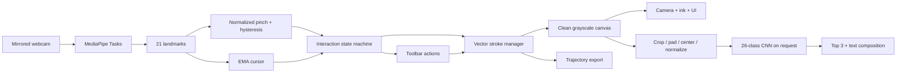

# AirWrite Vision

A real-time computer-vision system that converts hand gestures and fingertip
trajectories into digital handwriting and recognized text.

## Overview

Write with index and middle fingers raised. Raise only your index finger to
reposition or select toolbar actions; close your hand into a fist to erase. Recognize
one letter at a time, then build text using ADD.
The desktop application keeps editable vector trajectories separate from the
camera display and recognition canvas. It runs locally and does not save webcam
images. Drawing remains available without trained recognition weights.

The local three-epoch baseline achieved **93.36% on 20,800 official EMNIST Letters
test samples**. This does not measure air-writing accuracy. See
[validation details](docs/validation.md) for the split, checkpoint and checks.

## Features

- MediaPipe Tasks hand tracking in VIDEO mode with monotonic timestamps.
- Palm-normalized pinch hysteresis and motion-adaptive cursor smoothing.
- Explicit hover/draw/erase states; tracking loss splits strokes immediately.
- Vector segment erasing, multi-stroke drawing, undo (last 100 edits), clear.
- Gesture-operated toolbar and full keyboard fallbacks.
- Clean PNG export, top-three letter predictions and character-by-character text.
- CNN training, validation, held-out evaluation and custom sample collection.
- Rolling FPS, debug landmarks and anonymous session statistics.
- Camera-free unit and integration tests.

## Architecture



## Technology Stack

Python 3.11, OpenCV, MediaPipe Tasks Vision, NumPy, Pillow; optional PyTorch and
Torchvision for ML; Pytest and Ruff for development. No deprecated
`mp.solutions.hands` API is used.

## Installation

Run commands from this repository's `airwrite-vision` directory. Install a full
Python 3.11 distribution, then use PowerShell:

```powershell
python -m venv .venv
.\.venv\Scripts\Activate.ps1
python -m pip install --upgrade pip
python -m pip install -e ".[dev,ml]"
```

If activation is disabled, use `.\.venv\Scripts\python.exe` instead of `python`.
For Command Prompt, activate with `.venv\Scripts\activate.bat`. On macOS/Linux,
use `python3.11 -m venv .venv` and `source .venv/bin/activate`.
`pip install -e .` installs drawing only; ML and dev extras are optional.
OpenCV requires a desktop display; do not replace it with a headless build.
MediaPipe also installs the OpenCV contrib wheel. Both OpenCV distributions are
pinned to the same tested version because they share the `cv2` import namespace;
upgrade them together rather than allowing mismatched major versions.

## Model Download

```powershell
python scripts/download_models.py
```

Installs Google's official `models/hand_landmarker.task`; existing files are
retained unless `--force` is supplied. Missing assets produce an explicit setup
message. The CNN is trained separately and is never downloaded implicitly.

## Running the Application

```powershell
python -m airwrite.app
python -m airwrite.app --camera 1 --debug
python scripts/run_camera_test.py
```

On this workspace, `powershell -ExecutionPolicy Bypass -File .\run.ps1` uses the
prepared local Python runtime and downloaded/trained models. The launcher prefers
a project `.venv` if present. The portable runtime lives outside the repository
in `../.tools/`; use the standard installation above when cloning elsewhere.

Default resolution is 640×480, using actual delivered dimensions for all geometry.
Capture requests 60 FPS and a small buffer where the camera backend supports it;
the displayed FPS is measured, not guaranteed. Adaptive smoothing filters small
movements but follows movements of 24 pixels or more directly to reduce lag.
The stroke jump cutoff is 240 pixels per observed frame; tracking loss still
ends the stroke. Fast paths between observed points are connected with lines;
motion blur or movement that the camera never captures cannot be reconstructed.
Face your palm toward the camera in good light. Keep the hand visible and write
one large letter in the area between the toolbar and status panel. The window
must have keyboard focus. Q or closing the window releases camera/task resources.

Tuning example:

```powershell
python -m airwrite.app --pinch-start 0.30 --pinch-release 0.45 --alpha 0.4
```

Other options: `--hand-model PATH`, `--character-model PATH`. Dataclasses in
`src/airwrite/config.py` hold camera, tracking, gesture, drawing and recognition
settings including point-distance/jump limits, eraser size and output paths.
All default asset/data paths are relative to the working directory.

## Gesture Controls

Finger controls are the default:

| Hand shape | Action |
| --- | --- |
| Only index finger raised | Hover and select toolbar options |
| Index + middle fingers raised (V sign) | Write with the index fingertip |
| Fully closed fist, thumb tucked | Erase around the middle-finger knuckle |
| Open palm, other shapes or no hand | Stop drawing/erasing |

With only your index finger raised, hover over a toolbar button for **0.8 seconds**
to select it. The ring around the cursor shows progress. Move away or lower the
finger before selecting the same button again. In optional pinch mode, pinch to
click a toolbar button. UNDO, CLEAR, SAVE, RECOGNIZE and text actions work this way.
SAVE writes ink only to `outputs/drawings/`.

The toolbar sits inside the camera frame, with 64 pixels of space above it and
48 pixels at each side at 640×480. This keeps controls reachable without moving
your hand to the frame edges. Margins scale with capture size and can be adjusted
with `toolbar_top_margin` and `toolbar_side_margin` in `DrawingConfig`.

Keep the palm facing the camera and curl unused fingers. Your thumb may relax
while writing/pointing, but tuck it across curled fingers for the fist eraser.
Writing activates after 35 ms; other shapes require 120 ms. Once writing is
active, finger-angle hysteresis tolerates slight bends without stopping the
stroke. Switching to the pointer or another shape stops the current action
immediately. Joint angles and relative reach support either hand
and in-plane hand rotation; severe sideways poses/occlusion can still fail.

**G** or the **GESTURES** button toggles between finger controls and the original
pinch mode. Selecting PEN/ERASER (or P/E) explicitly switches to pinch mode, where
pinching draws/erases with the chosen tool and release allows repositioning.
Start directly in this mode with `python -m airwrite.app --control-mode pinch`.
Use G to return to automatic finger-controlled pen/eraser switching.

RECOGNIZE displays three candidates with softmax scores. ADD commits the top
candidate and clears the drawing; SPACE, BACKSPACE and CLEAR TEXT edit the text.
Changing ink invalidates previous predictions so ADD cannot commit a stale result.
Text is session-only; drawing saves and statistics do not persist the text buffer.

## Keyboard Controls

| Key | Action |
| --- | --- |
| P / E | Select pen / eraser and switch to pinch mode |
| G | Toggle automatic finger controls / pinch mode |
| U / C | Undo / clear canvas |
| R / S | Recognize / save drawing (collect a sample in collector mode) |
| A or Enter | Add top prediction to text |
| Space / Backspace | Insert space / remove last text character |
| X | Clear text |
| D | Toggle landmark and pinch diagnostics |
| Q | Quit |

## Training Character Recognition

```powershell
python -m airwrite.ml.train --epochs 10 --batch-size 128
python -m airwrite.ml.evaluate
```

Torchvision downloads EMNIST Letters on first use (the archive includes other
splits and is large). Native labels 1–26 become 0–25 → A–Z. **EMNIST Letters
includes both uppercase and lowercase shapes**, merged into 26 letter classes;
the application's output alphabet is uppercase. This is not an uppercase-only
training dataset.

Raw EMNIST images are transposed to upright orientation. Training writes
`data/processed/emnist_orientation.png`, a labeled sample grid to inspect before
interpreting results. Dataset and runtime use the same crop/pad/center/polarity
preprocessing. A seeded 90/10 split of the training partition provides validation;
the official test partition is used only by evaluation.

The small CNN uses three convolution layers, batch normalization, pooling and
dropout. Training uses CrossEntropyLoss and AdamW, selects CUDA when available,
and otherwise runs on CPU. Seeds are fixed; exact results can still differ across
hardware/library versions. The best validation checkpoint is written atomically
to `models/airwrite_cnn.pt`, with epoch metrics in `models/airwrite_cnn.history.json`.
`--seed`, `--learning-rate`, `--data-dir`, `--output` and `--limit` are configurable.
Use `--limit 1024 --epochs 1` for a short pipeline check, not an accuracy estimate.

Evaluation writes overall/per-class accuracy and a 26×26 confusion matrix to
`outputs/predictions/evaluation.json`; rows are true labels, columns predicted.
No accuracy claim should be made without identifying the checkpoint and test set.

## Collecting Custom Air-Writing Data

```powershell
python scripts/collect_airwriting_data.py --label A
```

Write A, then press S or pinch SAVE. Each save creates `data/custom/A/A_0001.png`
and `A_0001.json`, clears the canvas and prepares the next sample. Existing sample
names are never overwritten. JSON contains label, canvas dimensions and separate
strokes with `{x, y, t}` points; time is relative to the first retained point.
The collector saves handwriting only, never camera frames.

Fine-tune a baseline with EMNIST plus collected images:

```powershell
python -m airwrite.ml.train --checkpoint models/airwrite_cnn.pt --custom-dir data/custom --epochs 3 --learning-rate 0.0001
python -m airwrite.ml.evaluate --custom-dir data/custom_holdout --output outputs/predictions/custom_evaluation.json
```

Custom samples augment training only. Keep evaluation writers/sessions in a
separate holdout directory to avoid leakage. EMNIST supplies the baseline;
custom samples address the difference between scanned handwriting and air-written
trajectories. Custom performance is not implied by EMNIST validation accuracy.

## Project Structure

```text
models/                 Downloaded task and trained CNN (Git-ignored)
data/{raw,processed,custom}/
outputs/{drawings,predictions}/
scripts/                Model download, camera test, sample collector
src/airwrite/
  app.py                Session orchestration and action dispatch
  config.py             Configuration dataclasses
  camera.py             Capture lifecycle
  hand_tracker.py       Tasks adapter and observation dataclasses
  gestures.py           Normalized pinch geometry and hysteresis
  smoothing.py          Point filter
  interaction.py        States, tools and toolbar gesture capture
  strokes.py            Vector editing and undo
  canvas.py             Clean raster rendering and PNG export
  preprocessing.py      Shared recognition normalization
  recognizer.py         Optional model loading and inference
  collection.py         Paired image/trajectory samples
  ui.py                 Toolbar and status overlays
  metrics.py            FPS and anonymous runtime statistics
  ml/                   Dataset, CNN, train and evaluate
tests/                  Camera-free checks
```

## Recognition Pipeline

The clean canvas uses white foreground on black. Preprocessing finds ink bounds,
crops empty space, adds 10% padding, scales proportionally into 24×24 (roughly
20×20 ink), centers in 28×28 and normalizes to [0, 1]. Inference consumes a
1×1×28×28 tensor. Empty drawings are rejected. The model is loaded once; inference
runs only when requested and briefly blocks the tracking loop. Confidence is a
softmax score, not a calibrated guarantee. Missing/corrupt weights leave drawing
available with an explanatory message.

## Testing

```powershell
python -m pytest
python -m ruff check .
python -m ruff format --check .
```

Tests do not require a webcam or downloaded datasets. Optional ML tests skip if
PyTorch/Torchvision are absent. Real-time acceptance still requires a webcam:
check mirrored capture, cursor alignment, release/reposition, tracking loss,
toolbar gestures, undo/erase, saved PNGs, recognition and clean shutdown.

## Limitations

- One tracked hand and one character per recognition request; no cursive words.
- Lighting, occlusion, perspective and fast motion affect tracking. Loss ends a
  stroke immediately to prevent accidental bridges; brief losses can fragment ink.
- The eraser sweeps a continuous 32-pixel-radius corridor between tracked positions,
  including pen width at the edge. It follows the fist without pen-smoothing delay.
  Tracking loss, leaving the writing area or a jump over 240 pixels breaks the
  sweep. Undo restores a continuous eraser gesture.
- Palm normalization reduces distance sensitivity but is not full 3D calibration.
- No measured air-writing accuracy or real-time FPS guarantee without a local
  camera session and a held-out air-writing dataset.
- Session JSON reports FPS including pauses for user-requested inference/save,
  detected/lost frames, remaining stroke count/points and prediction scores.
- Undo stores up to 100 vector snapshots; long sessions use more memory.
- EMNIST and MediaPipe assets retain their own terms. See `models/README.md`.

If the camera cannot open, close competing camera apps, allow desktop camera
access in OS privacy settings, or try `--camera 1`. Use the camera-test script to
isolate capture from model issues. Retrain incompatible checkpoints with this
version. Redownload a damaged hand task with `--force`.

## Future Improvements

One Euro/Kalman filters, hand calibration, alternative gestures, asynchronous
inference, writer-independent custom evaluation and trajectory-based recurrent or
Transformer models can be added behind the existing component boundaries.
Continuous word recognition, multilingual symbols and web deployment are future
work, not current capabilities.

## References

- [MediaPipe Hand Landmarker Python guide](https://ai.google.dev/edge/mediapipe/solutions/vision/hand_landmarker/python)
- [Torchvision EMNIST API](https://docs.pytorch.org/vision/stable/generated/torchvision.datasets.EMNIST.html)
- [EMNIST dataset and provenance](https://www.nist.gov/itl/products-and-services/emnist-dataset)

Project code is MIT licensed; see [LICENSE](LICENSE).
